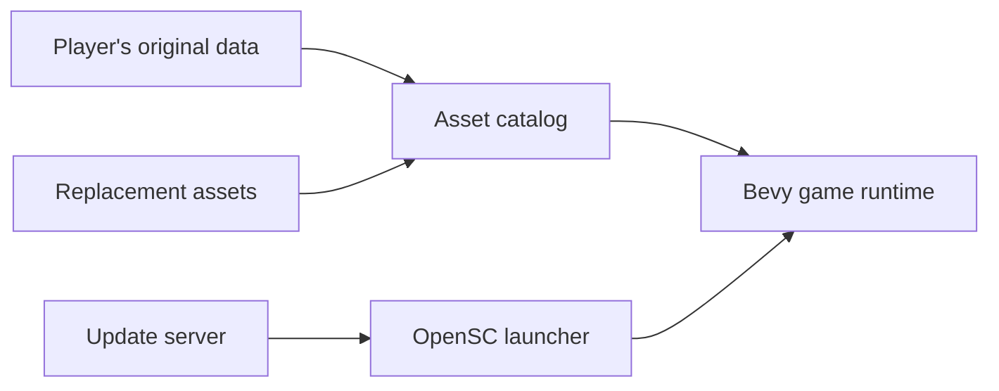

# OpenSC — Open Shadow Company

A modern **Rust + Bevy** reimplementation of **Shadow Company: Left for Dead**,
with a native launcher and an update server. OpenSC reads the player's original
resources and supports replacement assets through the same catalog.

[Download & install](https://shadow-test.zaikinagroup.ru/) · [Engine](engine/README.md) ·
[Contributing](CONTRIBUTING.md) · [Changelog](CHANGELOG.md) · [Русский](README.ru.md)

**Status:** a playable training prototype. The complete campaign and full
compatibility with the original executable are still in development. You need
your own original game installation or disc image; original archives are not
included in engine updates. Current gameplay work is tracked in
[PR #2](https://github.com/STG-44/opensc/pull/2); see the engine guide before
building the active development branch.

## Play

1. Download the launcher for your system from the [project website](https://shadow-test.zaikinagroup.ru/).
2. Choose your original game folder, **MDF/MDS**, or **ISO**. Supported data is
   copied automatically into OpenSC's managed library.
3. Let the launcher install the engine, then select **Play → Training**.

Launcher **0.4.1** checks for engine updates automatically. Game data, settings
and overrides stay separate from versioned engine installations. Launcher
self-updates use a signed channel; older launchers may need one manual upgrade.
[Import details — Russian](docs/IMPORTING-RU.md).

## Current features

| Area | Implementation |
| --- | --- |
| Original resources | GUT archives, SMF models, BMF animation, MTF placement, PCX terrain and textures |
| Menus | Animated backgrounds and buttons, Unicode fonts, Russian/English UI, AVI playback with sound |
| Tactical controls | John and recruited Jack, selection, stances, group movement and obstacle detours |
| Training | Weapons and items, medical kit, armor, body carrying, fences, gates, Hummer and evacuation |
| Inventory | Original panel layout, equipment, backpack grid, ammunition indicators and skills |
| Radar | Live team markers, detected enemies, camera footprint, map lock/rotation, zoom and dragging |
| Visibility | Shared team sight, terrain/scenery occlusion and persistent radar exploration |
| Delivery | Verified versioned downloads, automatic updates and a private bug-report service |

The renderer uses Bevy's **wgpu** backend; Vulkan is verified on Linux.
The UI supports modern **16:9 and 21:9** windows starting at **1280×720**.

## Platforms

| Component | Build targets |
| --- | --- |
| Engine | Linux x86-64 / ARM64, Windows x86-64, macOS Intel / Apple Silicon |
| Launcher | Linux x86-64, Windows x86-64, macOS Intel / Apple Silicon |
| Update/report server | Linux container |

[Engine CI](https://github.com/STG-44/opensc/actions/workflows/engine.yml) builds
and checks all five engine targets. Native rendering and injected mouse/UI
scenarios are exercised on Linux; Windows and macOS still need hands-on
rendering checks. Current Linux engine packages target glibc 2.35+, while
launcher packages require glibc 2.39+. Compatibility with every distribution
and musl-based systems is not yet guaranteed.

## Repository

| Path | Purpose |
| --- | --- |
| [`engine/`](engine/README.md) | Rust **1.99.0**, Bevy **0.20.0**, resource readers, tools and game runtime |
| [`src/`](src/) | Native launcher, original-data import and update client |
| [`server/`](server/README.md) | Rust/Axum file delivery and private SQLite bug reports |
| [`crates/report-protocol/`](crates/report-protocol/) | Shared report validation |
| [`scripts/`](scripts/) | Packaging, release checks and installers |
| [`deploy/`](deploy/README.md) | Website and deployment references |

Start with the [contributor guide](CONTRIBUTING.md) and
[radar, visibility and navigation](engine/docs/TACTICAL-SYSTEMS.md).
Detailed implementation/research notes remain in the [Russian engine guide](engine/README.ru.md).

## Report a problem

Use the launcher's report function or [open an issue](https://github.com/STG-44/opensc/issues/new/choose).
Include the engine/launcher version, platform, reproduction steps and expected
result. A screenshot or short video helps with rendering and UI problems.

## Attribution and licensing

OpenSC is an independent recreation, not an official or endorsed release.
Original game data and trademarks belong to their respective owners.
Dependency and font notices are included in packaged builds.

Project-owned source code is licensed under the [MIT License](LICENSE).
Dependencies, fonts and original game assets retain their respective terms.
