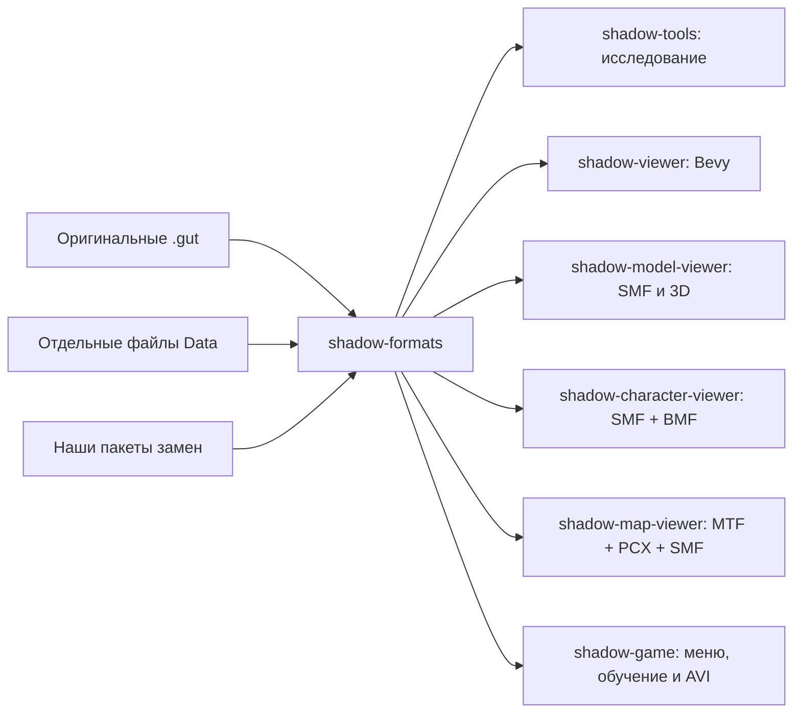

# Архитектура первого этапа

Цель проекта — независимая реализация Shadow Company на Rust и Bevy, которая использует данные установленного оригинала и подключаемые улучшения.

## Чтение GUT

Заголовок содержит текстовую преамбулу и восьмибайтовую сигнатуру. После сигнатуры идут число записей и 32 байта имени архива. Запись таблицы состоит из пяти little-endian u32: длина имени, размер данных, относительное смещение, признак кодирования, поле контрольной суммы. Байты имени XOR-кодированы значением 0xff. При установленном признаке этим же способом закодированы данные ресурса.

Смещение отсчитывается от начала таблицы. Читатель проверяет размеры, границы данных и пути. Таблица индексируется один раз, содержимое нужного файла читается по запросу через seek. Ограничения прототипа: преамбула до 64 КиБ, до 100 000 записей, имя до 4 096 байт, один ресурс до 512 МиБ.

Алгоритм оригинального поля контрольной суммы пока не установлен. Инструмент `archive --hash` отдельно рассчитывает SHA-256 декодированных данных; он не объявляет оригинальное поле проверенным.

## Поиск ресурса

Windows-разделители заменяются на `/`, регистр имён нормализуется. Нельзя использовать абсолютные пути и `..`. Символические ссылки при индексации отдельных файлов пропускаются. Конфликт двух имён, различающихся только регистром, возвращает ошибку.

Приоритет: **GUT → отдельные файлы Data → папка наших замен**. Индекс каждой следующей ступени перекрывает предыдущую. Улучшение сохраняет внутренний путь оригинального ресурса. Новые форматы улучшений можно будет добавить через явное сопоставление имён после появления загрузчика моделей.

Пока `shadow-viewer` напрямую получает байты от `AssetCatalog` и создаёт `Image`. После проверки моделей подключим этот каталог к `AssetReader` Bevy и напишем `AssetLoader` для собственных типов. Это позволит постепенно перейти к асинхронной загрузке и обработке зависимостей.

## Следующие этапы

1. Выполнено: прочитать SMF 1.0/1.1, сверить все 995 оригинальных файлов и подключить статическую геометрию к 3D-просмотрщику. Формат и ограничения описаны в [SMF-RU.md](SMF-RU.md).
2. Выполнено: прочитать все 271 BMF, собрать тело/голову, подключить таз и траекторию корня, воспроизвести ходьбу, бег и жест с переходами. Следом — карта, навигация и совместимость разных скелетов. [BMF-RU.md](BMF-RU.md).
3. Выполнено: прочитать MTF/PCX, показать карту и поставить одного анимированного бойца на рельеф. Приказы мышью, ходьба/бег, остановка и камера подключены. Следом — препятствия и навигация. [TRAINING-RU.md](TRAINING-RU.md).
4. Выполнено: главное меню с современным Unicode-текстом и адаптацией 16:9/21:9 от HD, действующие настройки, загрузка обучения и переходы паузы. Вступление MJPEG/PCM воспроизводится со звуком и пропуском. Следом — остальные меню оригинала. [Найденные ресурсы и порядок реализации](MENUS-RU.md).
5. Выполнено: импортировать сценарий обучения, задания, события, подсказки и профиль начального бойца; сцена начинает с Джона без оружия в исходной точке. Подбор ножа, BDA, граната, три часовых, кусачки и проход через сетку уже действуют. Стойки S/C/P, UZI и шесть охранников также действуют: четыре основные задачи. Следом — лечение и техника, затем игровая симуляция: выбор отряда, столкновения, ИИ, бой, условия миссий и оставшиеся окна интерфейса.
6. Добавить отдельный Rust-лаунчер и подписанные обновления с подготовленного сервера.

Целевые ОС — Windows, Linux и macOS, с общей логикой и отдельными нативными сборками. Подготовленная матрица CI и правила упаковки описаны в [PLATFORMS-RU.md](PLATFORMS-RU.md). Фактическая проверка сборки и окна пока выполнена на CachyOS. Сохранения оригинального EXE, другие кодеки AVI и полная совместимость миссий ещё требуют отдельных реализаций и проверок.

Главное меню реализовано в `frontend.rs`; общий код карты перенесён из точки входа `map.rs` в `training.rs`. Разметка меню — в `shadow-formats/src/menu.rs`, настройки — в `preferences.rs`. Приложение использует состояния и фоновую подготовку `Session`; подробности — [MENUS-RU.md](MENUS-RU.md).

AVI-парсер и PCM-итератор находятся в `shadow-formats/src/avi.rs`, фоновое декодирование кадров и собственный Bevy-аудиоисточник — в `movie.rs`. Исходный сжатый файл общий через `Arc`, число декодируемых кадров ограничено. [Подробности](AVI-RU.md).

Сценарии и профили читаются в `shadow-formats/src/mission.rs`, `help.rs` и `character.rs`. `shadow-tools mission` проверяет связанные ресурсы без окна, а учебная сцена использует ID менеджера игрока для выбора актёра MTF. [Последовательность обучения](MISSIONS-RU.md).

## Первый игровой предмет

`pickup.rs` готовит нож и геометрию выбора при загрузке, связывает ID MTF с сущностью карты и переключает видимость подготовленных частей в кисти. `tutorial.rs` хранит очередь одиночных задержек CER и состояние подсказок. Завершение первой боевой задачи не подменяется подбором предмета. [Границы исполнения и учебный разбор](PICKUP-RU.md).

Стойки загружаются в `stance.rs`; постоянный `Posture` отделён от временных действий. `smg.rs` отвечает за размещённый в MTF предмет, инвентарь — за владение и два независимых магазина, `combat.rs` — за очередь и событие гибели всей группы. [Устройство и ограничения](SMG-RU.md).
