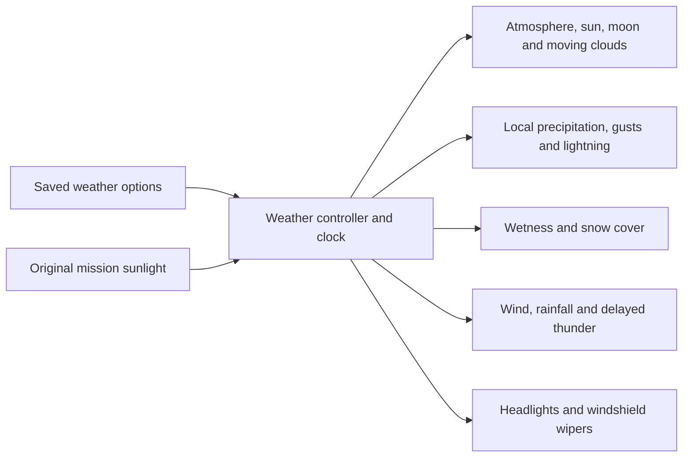

# Sky and weather presentation

Weather remains in development after the published Test package. Native checks
on macOS with a Radeon Pro 555X covered clear daylight and night in Low, clear
daylight in Medium, fog in High, and rain, snow and thunderstorms in Low. A weather
release still needs coverage across the full set of presets and quality levels.

The weather system runs locally after the frozen 2026-11-05 Test candidate.
Its rendering must remain independent of map dimensions and preserve original
resource bytes. The first implementation targets these conditions: clear sun,
clouds, overcast, drizzle, rain, downpour, thunderstorm/lightning, fog, snow,
sleet, hail, dust storm and blizzard.

The training clock starts at the map's authored time, 12:04, unless the player
chooses a starting hour. The HUD and the debug panel display the same clock.
The sun follows a continuous path that passes below the horizon at night.
Mission lighting takes its sunlight tint from the hourly source table. The
clock and weather progression pause with the mission.

The selected weather preset stays active until the player changes it. Training's
Mission preset starts clear. Presets define cloud cover, precipitation, wind,
visibility and temperature. Wind moves clouds and particles, precipitation
accumulates wetness or snow, and a deterministic seed controls the timing and
location of lightning in storm conditions. Weather settings live outside the
original installation.

Medium/high quality use Bevy's atmospheric scattering lookup tables. Low quality
provides an analytic sky, exposure-scaled ambient daylight and fewer cloud and
precipitation samples. Cloud layers use an embedded shader. Rain and snow use
bounded, reusable particle pools near the camera. Expensive surface changes are
throttled. Lightning uses a bounded flash envelope, with thunder delayed
according to strike distance.

The sky dome integrates ground haze using the camera's fog color and extinction.
The optical path grows toward the horizon, blending the atmosphere background
into distant terrain in fog and dust.

During training, F6 opens the weather debug panel. F7 cycles weather presets and
F8 moves the displayed time forward by one hour. Shift reverses F7 and F8. F4
freezes or resumes the clock from its displayed time. Shift+F6 restores the options
used at the start of training. Debug changes last for the current session. Use
the Weather tab in the options menu to save preferences. F7 and F8 jump to the
selected preset or hour for debugging. Preset changes through the options menu
blend over 12 seconds of active simulation. The full day lasts 120 real minutes
at the default speed.

The initial performance target is older discrete GPUs including the reported
Radeon 555X/8870M. Software rendering supplies correctness screenshots only;
hardware performance claims require measurements on those devices. The design
does not add terrain streaming, fluid simulation or a meteorological model.
Future work can replace the cloud integrator or particle backend without changing
the controller/equipment contract.
