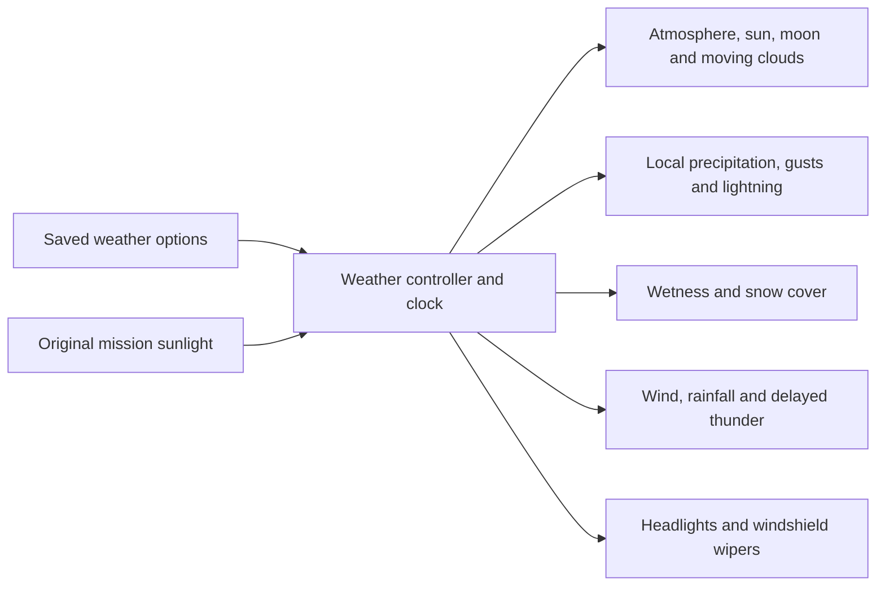

# Sky and weather presentation

Status: work in progress, preserved from the 2026-11-06 transfer. This source
checkpoint is not part of the published Test package. Low-quality ambient
lighting, the full native weather matrix and final workspace checks still need
validation before a weather release.

The weather system runs locally after the frozen 2026-11-05 Test candidate.
Its rendering must remain independent of map dimensions and preserve original
resource bytes. The first implementation targets these conditions: clear sun,
clouds, overcast, drizzle, rain, downpour, thunderstorm/lightning, fog, snow,
sleet, hail, dust storm and blizzard.

The controller owns bounded, finite physical presentation parameters and blends
between presets. Simulation time pauses with the mission. A deterministic seed
supports reproducing storms and capturing the same state. The mission's original
sunlight remains the initial reference; explicit time overrides are presentation
settings. Weather settings live outside the original installation.

Medium/high quality use Bevy's atmospheric scattering lookup tables. Low quality
provides an analytic sky and fewer cloud/precipitation samples. Cloud layers use
an embedded shader; rain and snow use bounded reusable local pools rather than
one entity for every drop or a particle volume covering the whole map. Expensive
surface changes are throttled. Lightning uses a bounded flash envelope, with
thunder delayed according to strike distance.

The initial performance target is older discrete GPUs including the reported
Radeon 555X/8870M. Software rendering supplies correctness screenshots only;
hardware performance claims require measurements on those devices. The design
does not add terrain streaming, fluid simulation or a meteorological model.
Future work can replace the cloud integrator or particle backend without changing
the controller/equipment contract.
