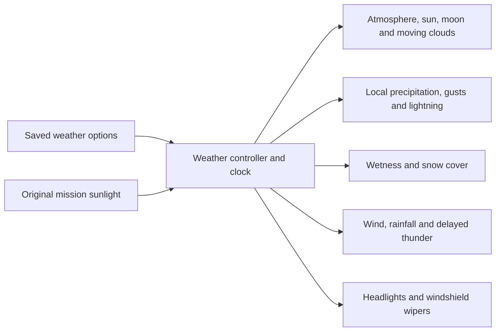

# Sky and weather presentation

Weather remains in development after the published Test package. Native checks
on macOS with a Radeon Pro 555X covered clear daylight and night in Low, clear
daylight in Medium, fog in High, and rain, snow and thunderstorms in Low. A weather
release still needs coverage across the full set of presets and quality levels.

The weather system runs locally after the frozen 2026-11-05 Test candidate.
Its rendering must remain independent of map dimensions and preserve original
resource bytes. The first implementation targets these conditions: clear sun,
clouds, overcast, drizzle, rain, downpour, thunderstorm/lightning, fog, snow,
sleet, hail, dust storm and blizzard.

The controller owns bounded, finite physical presentation parameters and blends
between presets. Simulation time pauses with the mission. A deterministic seed
supports reproducing storms and capturing the same state. The mission's original
sunlight remains the initial reference; explicit time overrides are presentation
settings. Weather settings live outside the original installation.

Medium/high quality use Bevy's atmospheric scattering lookup tables. Low quality
provides an analytic sky, exposure-scaled ambient daylight and fewer cloud and
precipitation samples. Cloud layers use an embedded shader. Rain and snow use
bounded, reusable particle pools near the camera. Expensive surface changes are
throttled. Lightning uses a bounded flash envelope, with thunder delayed
according to strike distance.

The initial performance target is older discrete GPUs including the reported
Radeon 555X/8870M. Software rendering supplies correctness screenshots only;
hardware performance claims require measurements on those devices. The design
does not add terrain streaming, fluid simulation or a meteorological model.
Future work can replace the cloud integrator or particle backend without changing
the controller/equipment contract.
